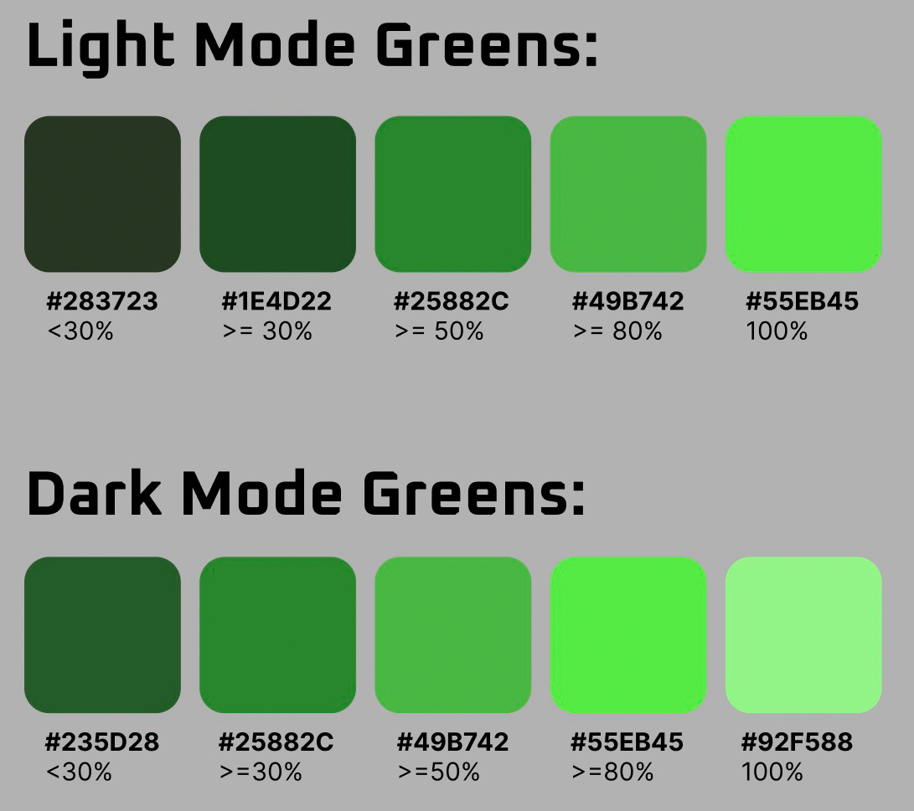

# StepCounter  

A minimalistic, modern looking step counter.  

Only permissions needed are for health connect and optional background access in health connect, if you want to use widgets.  

In the monthly widget the colors are calculated on how many percent of your goal you have reached on the specific day.  
The exact values can be seen below:  
 

